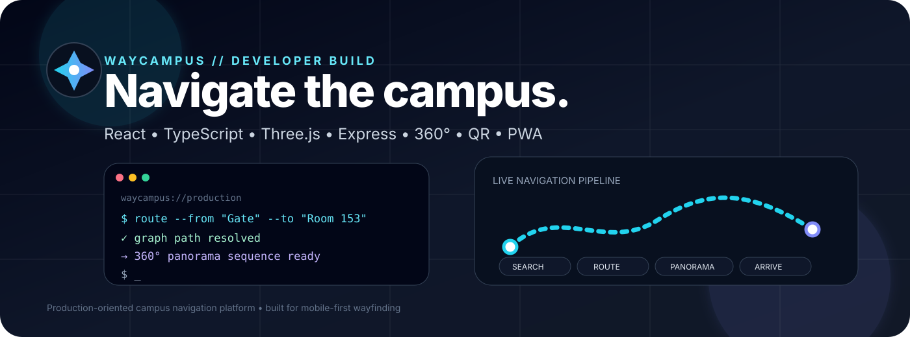
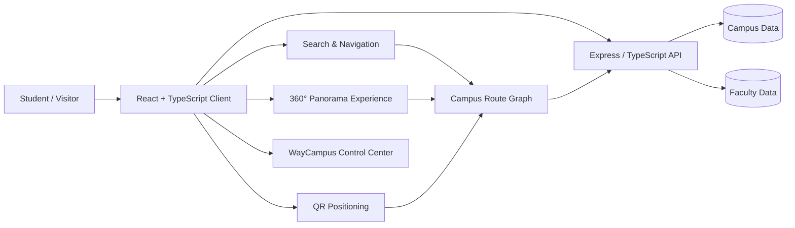

# WayCampus

<p align="center">
  
</p>

<p align="center">
  <a href="https://campnav-b3om.onrender.com"></a>
  <a href="https://campnav-naf9.onrender.com/api/v1/health"></a>
  
  
  
  
</p>

<p align="center">
  <em>Campus navigation, treated like a real product — not a demo.</em>
</p>

## ⚡ Developer Snapshot

| | |
|---|---|
| **Frontend** | React 19 + TypeScript + Vite |
| **3D / Navigation UI** | Three.js + React Three Fiber + Drei |
| **Backend** | Node.js + Express + TypeScript |
| **Positioning flows** | QR landmarks + navigation graph |
| **Data model** | Shared TypeScript models + campus JSON |
| **Deployment** | Render |
| **Repository** | Private GitHub monorepo |

> **Current product:** graph-based indoor navigation + linked 360° panorama movement + QR positioning + campus directory/faculty workflows.  
> **Future direction:** markerless AR wayfinding and multi-college deployment.

### 🧩 Product Modules

```text
┌─────────────────────────────────────────────────────────────┐
│ WAYCAMPUS                                                   │
├──────────────┬───────────────┬──────────────┬───────────────┤
│ Search       │ Route Graph   │ 360° Tour    │ QR Position   │
│ destinations │ pathfinding   │ panoramas    │ known start   │
├──────────────┴───────────────┴──────────────┴───────────────┤
│ Control Center • Faculty Portal • PWA • API                │
└─────────────────────────────────────────────────────────────┘
```

### 🛠️ Engineering Workflow

```text
change
  ↓
GitHub push / pull request
  ↓
CI build + lint
  ↓
Render deployment
  ↓
health check
  ↓
live WayCampus
```


## ✦ What is WayCampus?

WayCampus is a campus-scale navigation platform built around a **route graph + destination search + 360° panoramic navigation experience**.

It is designed for students, visitors, faculty, and campus staff who need a fast way to find rooms, buildings, facilities, and accessible routes across a complex campus.

### Core experience

- 🧭 **Indoor route guidance** — graph-based pathfinding connects campus navigation nodes.
- 🔎 **Destination search** — search places and campus destinations from the main interface.
- 🌐 **360° navigation** — move through linked panoramas as a virtual/guided walk.
- 📍 **QR landmark positioning** — QR destinations can establish a known starting point.
- 🏫 **Campus directory** — building and academic information can be surfaced alongside navigation.
- 👨‍🏫 **Faculty portal** — faculty-related campus information is integrated into the application.
- 🛠️ **Control Center** — administration/debug tooling is included for campus operations and verification.
- 📱 **PWA-ready client** — installable web-app behavior is supported for mobile-first campus use.

## 🧱 Architecture



## 🧰 Tech stack

| Layer | Technology |
| --- | --- |
| Frontend | React 19, TypeScript, Vite |
| Styling | Tailwind CSS |
| 3D / Panorama | Three.js, React Three Fiber, Drei |
| Icons & UI | Lucide React |
| QR | jsQR, qrcode |
| Backend | Node.js, Express, TypeScript |
| Auth / security | bcryptjs, JSON Web Tokens |
| Data | Campus JSON data + shared TypeScript models |
| Deployment | Render |
| Source control | GitHub |

## 📁 Repository structure

```text
CampNav/
├── client/                 # React + Vite application
│   ├── public/             # Logos, icons, PWA assets, QR assets
│   └── src/
│       ├── components/
│       │   ├── ar/         # QR / AR-related UI
│       │   ├── canvas/     # 3D canvas components
│       │   ├── control-center/
│       │   ├── faculty/
│       │   ├── map/
│       │   ├── panorama/
│       │   └── screens/
│       ├── context/
│       ├── data/
│       ├── services/
│       └── utils/
├── server/
│   ├── data/               # Campus and faculty data
│   └── src/
│       ├── db/
│       ├── middleware/
│       ├── routes/
│       └── services/
├── shared/                 # Shared application types/data
├── scripts/                # Data / panorama utilities
├── render.yaml             # Render deployment configuration
├── vercel.json             # Vercel configuration
└── package.json
```

## 🚀 Local development

### 1. Install dependencies

```bash
npm install
cd client && npm install
cd ../server && npm install
```

### 2. Start the client

```bash
npm run dev
```

### 3. Start the server

In another terminal:

```bash
npm run dev:server
```

### Production build

```bash
npm run build
```

## 🌍 Current deployment

**Frontend:**  
https://campnav-b3om.onrender.com

**Backend health:**  
https://campnav-naf9.onrender.com/api/v1/health

Deployment configuration is kept in the repository so the application can be reproduced from source.

## 💾 Data Storage & Persistence

WayCampus uses **Google Cloud Firestore** as the single source of truth for runtime database records across development and production environments.

### Architecture Highlights
- **Zero Local Runtime Data Files**: The server does not write to local JSON files (`campusnav_db.json`), `DATA_DIR`, or disk snapshot folders at runtime. Ephemeral server instances (e.g. Render free tier) retain full state between deploys and restarts.
- **In-Memory Cache & Zero-Read Student Experience**: All read requests for public students/visitors are served 100% from the server's in-memory state. Firestore is read only once during cold startup (~350 reads) and whenever updates occur.
- **Real-Time Cross-Instance Sync**: Firestore `onSnapshot` real-time listeners automatically replicate faculty account creations, status changes, and graph updates across local dev Control Center instances and the live production Render instance without restarts.
- **Static Assets**: 360° panorama image files and map tiles remain high-performance static files served via HTTP/CDN, keeping database document sizes minimal.
- **Firestore Document Sizing**: Every collection and document schema is optimized (< 500 KB per document) to comfortably stay within Firebase's free Spark plan limits (50,000 reads/day, 20,000 writes/day, 1 GiB storage).

### Local Admin to Production Workflow
Administrators can run the Control Center locally (`npm run dev:client`) connected either to the local development server or directly to the production Render API (`https://campnav-b3om.onrender.com/api/v1`). Both point to the same Cloud Firestore database, ensuring instantaneous, consistent data management without manual export/import steps or git data commits.

## 🗺️ Navigation model

WayCampus treats indoor navigation as a graph:

```text
Destination
   ↓
Search result
   ↓
Route calculation
   ↓
Navigation nodes / edges
   ↓
360° panorama sequence
   ↓
Guided movement
```

This separation makes it possible to evolve the visualization layer without replacing the underlying campus route model.

## 🔭 Roadmap

### Now
- Reliable campus search
- Accurate destination → panorama linking
- Route validation
- Stronger admin data workflows
- Production monitoring and rollback safety

### Next
- Multi-college / multi-tenant architecture
- Better campus-content management
- More robust positioning and relocalization
- Native mobile navigation experience

### Future
- 📷 **Markerless AR wayfinding**
- 🧭 Live camera localization against mapped campus spaces
- 🟦 Floor-level AR route rendering
- 🏢 Multi-floor spatial navigation

> AR navigation is a future direction; this repository's current navigation experience is based on the existing graph, panorama, search, and QR systems.

## 🧪 Engineering principles

- **Preserve spatial truth.** Campus nodes, edges, panorama relationships, headings, and destination coordinates are source-of-truth data.
- **Change deliberately.** Navigation behavior should not be altered as a side effect of UI cleanup.
- **Validate before publishing.** Administrative data changes should be reviewable and reversible.
- **Mobile first.** Campus navigation is primarily a phone workflow.
- **No fake data.** The interface should represent verified campus information only.

## ⚠️ Security note

This repository currently contains credential-related files in the root directory. Those should **not** be treated as normal application assets.

Before making the repository public, move secrets/credentials out of Git history, store them as environment variables or another secure secret store, and rotate any credentials that may already have been exposed.

## 📌 Project status

**Active development**

WayCampus is being developed as a production-oriented campus navigation platform, with the current deployment serving as the foundation for future college installations.

---

<p align="center">
  Built for better campus mobility.<br/>
  <strong>WayCampus</strong> · Navigate with confidence.
</p>
